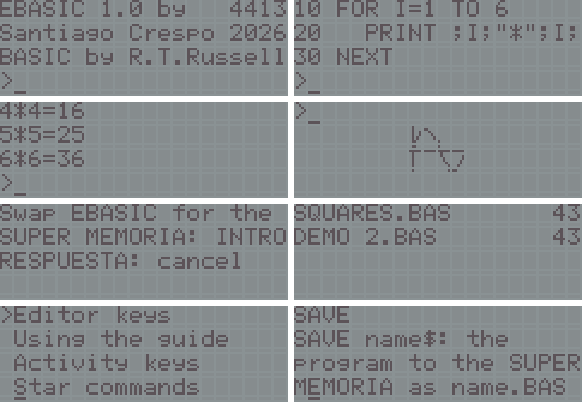

# EBASIC: a BASIC for the VTech Genio 2000

*By Santiago Crespo, 2026. The BASIC interpreter inside it is R.T. Russell's [BBCZ80](https://github.com/rtrussell/BBCZ80) (version 5.2, 2025).*

EBASIC is a 32 KiB cartridge for the Spanish VTech Genio 2000. It uses two 16 KiB pages at 0x8000 and starts automatically (`55 AA 59 45`). The interpreter is **R.T. Russell's BBCZ80**, assembled from his sources; around it, EBASIC adds a layer written for the Genio:

* a **screen editor**: three rows of program above a one-row prompt;
* a **guide** on the HELP key, with a page and an example for every keyword;
* **keyword keys** on the activity panel, which programs can also read;
* **sound**, a **20x16 pixel graphics window**, the **Z80 inline assembler**, and **Spanish text** with accented capitals;
* in a second, **experimental** image, **`SAVE`, `LOAD`, `CHAIN`, `*DIR`, `*ERA`, `*FORMAT` and data files** (`OPENIN`, `OPENOUT`, `BGET#`, `PRINT#`...) on the **Super Memoria** RAM cartridge, in SMFS, the format the text editor of [kresp0/vtech-genio2000](https://github.com/kresp0/vtech-genio2000) also uses: you swap EBASIC for the Super Memoria while the command runs.

| Image (`make` builds both) | Memory for programs | Super Memoria |
|---|---|---|
| `ebasic_gl2000_AT28C256_32K.bin` | 5,501 bytes | no: `LOAD`, `SAVE` and the file statements give `No filing system`, as before |
| `ebasic-sm_gl2000_AT28C256_32K.bin` | 4,413 bytes (1,088 hold the Super Memoria code) | **experimental**: on the owner's unit, swapping the EBASIC cartridge hangs or resets the unit more often than not, and a hang or reset loses the program in memory (see the Super Memoria section) |



*MAME snapshots of the ebasic-sm image, 4x enlarged: start, a program, RUN, a sine in the 20x16 graphics window, SAVE asking for the Super Memoria, `*DIR`, the guide's index and its page on SAVE (AYUDA). `tests/sheet.sh` makes this picture from `tests/shots.txt`.*

The language has integer, 40-bit float, string and byte variables, arrays, multi-line `DEF PROC`/`DEF FN` with `LOCAL` and recursion, `REPEAT`, `WHILE`, `CASE`, `EXIT`, `ON ERROR`, `EVAL`, `TIME`, `GET`/`INKEY`, `TAB(x,y)` and so on. Programs live in RAM; the ebasic-sm image can keep them on a Super Memoria cartridge.

**About the name.** EBASIC is not an official edition of BBC BASIC. The interpreter's sources say that the name "BBC BASIC" is used with the BBC's permission and does not transfer to derived works, so this cartridge has its own name. The interpreter modules are Russell's, assembled unchanged except for the banner lines. The first screen reads:

```
EBASIC 1.0 by   5501
Santiago Crespo 2026
BASIC by R.T.Russell
>
```

The number at the top right is the memory free for programs and variables (`HIMEM-LOMEM`), worked out at start-up (4413 in ebasic-sm). `REPORT` before any error shows the second and third lines, where the original showed Russell's notice.

**Machines.** Written for the Spanish VTech Genio 2000, and tested in MAME so far. It will most likely also work on its
relatives the Genius 4000, Genius LEADER 4000 Quadro, Genius LEADER 4004 Quadro L and PreComputer
Power Pad, but it has not been tried on them; their keyboards carry other legends, so the key names
used here and some typed characters may differ.

## Keys
The legends on the Genio's keys are in Spanish. This README and the cartridge call the special keys by English names:

| Name used here | Key legend | What it does |
|---|---|---|
| ENTER | INTRO | enters the line |
| ANSWER | RESPUESTA | Escape: stops a program, leaves the guide |
| HELP | AYUDA | opens the guide (SHIFT+HELP is TAB) |
| DELETE | REPETIR / BORRAR | deletes to the left |
| DEL | JUGADOR DERECHA / DEL | deletes to the right |
| LEFT, RIGHT | RETROCESO, AVANCE | move the cursor in the line; with ALT, to the start and the end |
| up, down | ALT+Ü, ALT+; | previous / next program line (in the guide: Ü and ; alone, or LEFT/RIGHT) |
| SHIFT, CAPS, ALT | MAYÚSCULAS, BLOQ. MAYÚSCULAS, ALT | as on the key legends; CAPS is on at start-up, because keywords are upper case |

* **SHIFT** gives `¡ ¿ # $ % / & * ( )` on the digits, `? ! " :` on `, . ' ;`, and `< >` on LEFT/RIGHT.
* **ALT** gives `\ @ - _ + [ ] =` on 1-8, as the red legends show. **ALT+9 = `|`** and **ALT+0 = `~`** are EBASIC's own choice: those keys have no red legend.
* **ALT + vowel** gives an accented vowel. SHIFT xor CAPS chooses upper or lower case, so with CAPS on, ALT+A gives Á and SHIFT+ALT+A gives á.
* **PAUSA** is `^`.
* **OFF** switches the unit off as soon as it is pressed (it must be held about 20 ms, against contact bounce). It is checked whenever the keyboard is read, so a program that never reads the keyboard or checks for Escape cannot be switched off this way.
* **`GET` codes in a program:** LEFT 136, RIGHT 137, down 138, up 139, ALT+LEFT 140, ALT+RIGHT 141, HELP 142, and the activity keys (below).

### Activity keys
Each key of the top panel types a common keyword, as on a Spectrum; OFF and ON are not used. In a running program, `GET`/`INKEY` return the codes below. The order is the panel's, column by column, top to bottom.

| Column | Key legend | Types | `GET` code |
|---|---|---|---|
| 1 | BUSCA LA LETRA | `PRINT` | 192 |
| 1 | RECUERDA LA PALABRA | `INPUT` | 193 |
| 1 | PLURALES | `IF` | 194 |
| 1 | VERBOS | `THEN` | 195 |
| 1 | REVOLTIJO DE LETRAS | `ELSE` | 196 |
| 2 | LA PALABRA MISTERIOSA | `FOR` | 197 |
| 2 | DERIVADOS | `TO` | 198 |
| 2 | SINONIMOS | `STEP` | 199 |
| 2 | ANTONIMOS | `NEXT` | 200 |
| 2 | LA LETRA LOCA | `GOTO` | 201 |
| 3 | LA NUEVA PALABRA | `REPEAT` | 202 |
| 3 | TRUEQUE DE LETRAS | `UNTIL` | 203 |
| 3 | ALFAPUZZLE | `WHILE` | 204 |
| 3 | REVOLTIJO | `ENDWHILE` | 205 |
| 3 | ACERTIJO GRAMATICAL | `GOSUB` | 206 |
| 4 | SUMA | `DEF` | 207 |
| 4 | RESTA | `PROC` | 208 |
| 4 | MULTIPLICACION | `FN` | 209 |
| 4 | DIVISION | `ENDPROC` | 210 |
| 4 | FRACCIONES / DECIMALES | `LOCAL` | 211 |
| 5 | FRACCIONES / PORCENTAJES | `DIM` | 212 |
| 5 | RATIOS | `GET` | 213 |
| 5 | ALGEBRA | `INKEY` | 240 |
| 5 | REPASO A LAS MATEMATICAS | `RND` | 241 |
| 5 | EL SIGNO PERDIDO | `INT` | 242 |
| 6 | CIENCIAS | `CHR$` | 243 |
| 6 | CINE Y TELEVISION | `LEFT$(` | 244 |
| 6 | HISTORIA Y GEOGRAFIA | `MID$(` | 245 |
| 6 | GENERAL | `LEN` | 246 |
| 6 | ¿QUE SOY? | `TAB(` | 247 |
| 7 | EL NUMERO RELAMPAGO | `CLS` | 248 |
| 7 | BASIC | `RUN` | 249 |
| 7 | IMPRIMIR TEXTO | `LIST` | 250 |
| 7 | CALCULADORA | `MODE` | 251 |
| 7 | CARTUCHOS ADICIONALES | `RETURN` | 252 |
| 8 | NIVEL | `SOUND` | 253 |
| 8 | 1 JUGADOR | `REM` | 254 |
| 8 | 2 JUGADORES | `END` | 255 |

## The screen editor
```
20 FOR I=1 TO 10       <- rows 1-3: the program lines before the one in the prompt
30   PRINT I*I            (their first 20 characters)
40 NEXT
>50 PRINT "fin"_       <- row 4: the prompt, the line being edited
```
* **Editing:** type anywhere in the line; DELETE and DEL delete, LEFT/RIGHT move, ALT+LEFT/RIGHT jump to the start / end. A long line scrolls sideways in its row.
* **ENTER:** a program line (it starts with a number) is stored and moves up into the view, and the prompt is left empty. A command runs on the whole screen.
* **Up / down:** bring the program line above / below into the prompt, and the view scrolls with it. A changed line is stored before moving.
* **After a command:** if it printed or drew something, the screen stays until a key is pressed, and that key is the first of the next line (ENTER and ANSWER only dismiss it). If it printed nothing, the editor comes back at once.
* **Errors** show on the top rows (as many as they need, up to three) and blink until the cursor moves or ENTER is pressed. An error in a program line loads that line into the prompt. If the program had printed something, the message first follows that output on the full screen.
* **`INPUT` and `AUTO`** use a plain console line.
* **Line length:** the prompt holds up to 253 characters. A program line whose listing is longer is cut when it is loaded, and stored cut if it is then changed.

## The guide (HELP)
* **Opening it:** HELP opens an index with three pages about EBASIC (five in ebasic-sm: also star commands and files), then one entry per keyword (all 145 of the interpreter's keywords and commands). With the cursor on a keyword, HELP opens that keyword's page directly.
* **In the index:** Ü and `;` (or LEFT/RIGHT, or ALT+Ü/ALT+;) move. A letter jumps to the first keyword with it. ENTER opens a page.
* **On a page:** the same keys scroll. A letter goes back to the index at that letter, ENTER copies the page's example into the prompt (ready to run or store), and ANSWER returns to the index.
* **The text** is in English, written for this cartridge. It comes from `help.txt` through `gen_help.py`, which:
  * checks that every keyword of the interpreter has an entry;
  * compresses the text (11.2 KB to 6.7 KB with the titles and the dictionary): byte pair encoding with 156 pairs, and one code for "the page's title", which most texts and examples repeat. A keyword's title is stored as its token, and the guide gets the name from the interpreter's own table;
  * lays every page out exactly as the cartridge does, and fails if one does not fit.

## The Super Memoria (ebasic-sm only, experimental): SAVE, LOAD, star commands, files
**Read this first.** These commands work when the swap of cartridges goes through, but on the owner's unit taking the EBASIC cartridge out or putting it back in hangs or resets the unit more often than not; the Super Memoria itself can be swapped without trouble. The likely cause is electrical, in the modified EEPROM cartridge (see Status), so it may differ on other boards. A hang or reset loses the program in memory, which may be the very program you wanted to save (a hang while taking EBASIC out happens before anything is written). Once `Done.` is on the screen the file is saved and checked, even if putting EBASIC back fails. Insert and remove the cartridge straight and in one movement, keep copies of what matters, and use the ebasic image if you do not need the Super Memoria. Swapping cartridges with the unit on is something the guide for the EEPROM cartridge advises against.

The Super Memoria is VTech's 32 KiB battery-backed RAM cartridge. EBASIC keeps programs on it in **SMFS** (`docs/SMFS.md` in [kresp0/vtech-genio2000](https://github.com/kresp0/vtech-genio2000)): up to 32 named files in 123 blocks of 256 bytes, a CRC for each file and one for the block table and the directory. It is not the format of the firmware's BASIC and text processor, and EBASIC does not read or write theirs. `*DIR` also lists the `.TXT` files of the text editor in that repository. Everything goes through the interpreter's own operating-system calls (`OSLOAD`, `OSSAVE`, `OSCLI`, `OSOPEN`, `OSBGET`...), so the syntax is BBCZ80's and the interpreter is unchanged.

| Command | What it does |
|---|---|
| `SAVE "name"` | saves the program as `NAME.BAS`; a file of that name is replaced (a command, as in BBCZ80) |
| `LOAD "name"` | loads `NAME.BAS` (a command) |
| `CHAIN "name"` | LOAD, then RUN; also in a program |
| `*DIR`, `*CAT`, `*.` | the files and their lengths, four at a time (INTRO: the next four, RESPUESTA: end), then the free bytes |
| `*ERA name`, `*DELETE name` | deletes `NAME.BAS` (the name may be in quotes) |
| `*FORMAT` | EBASIC's own: makes the cartridge an empty SMFS one, and everything on it is lost |

* **Swapping cartridges.** There is one slot, so every command asks: `Swap EBASIC for the` / `SUPER MEMORIA: INTRO` / `RESPUESTA: cancel`. Take EBASIC out, put the Super Memoria in and press INTRO. Then the result (`Done.` or the reason it failed) and `Put EBASIC back in:` / `INTRO`.
  * **Which cartridge is in** is decided, after each INTRO, from the 16-bit sum of pages 80 and 83 read twice, 0.3 s apart: the readings must agree (a cartridge that is still going in reads differently), and the sum must be EBASIC's to go back to it, or another one to go on. INTRO with the wrong cartridge in only asks again.
  * **RESPUESTA** at the request goes back to EBASIC only if EBASIC is in; if it has already been taken out, the program asks for it first, and then gives `Escape`.
  * **OFF** switches the unit off only when held for about 1.2 s after being seen released, as in `supermem-test`, so that a contact that bounces while a cartridge goes in or out cannot do it. A short press does nothing.
  * **The caps LED blinks** (about three changes a second) while the Super Memoria code waits for a key or checks the cartridge, so you can see it is still running; a LED that stops blinking means the unit has hung. Back in EBASIC the LED is as it was.
* **Names**: up to 12 characters of `A-Z 0-9 space . - _`, in either case (stored in upper case), with `.BAS` added. A name with a dot keeps its own extension: `LOAD "NOTES.TXT"` loads a text, which is not a program (`Bad program` or nonsense). Anything else is `Bad name`, before any swap.
* **Star commands** work at the prompt and in programs, in upper or lower case, and through `OSCLI "ERA NAME"`. `*` alone and `*|` (a comment) do nothing, as before; any other is `Bad command`.
* **Data files.** One file open at a time, of up to 720 bytes, kept whole in RAM (in the area reserved below HIMEM, see below). `OPENIN` and `OPENUP` read the whole file with one swap of cartridges; `OPENOUT` only starts an empty one. `BGET#`, `BPUT#`, `INPUT#`, `PRINT#`, `PTR#` (also set), `EXT#` and `EOF#` work on the copy in RAM. `CLOSE#` writes a file opened by `OPENOUT` or `OPENUP` with another swap (SAVE's way), and so does `END`, which closes files. The channel is 1. A name without extension gets `.DAT`. A file that does not exist is `File not found` (an error, not a 0 as on other machines). While a file is open, LOAD, SAVE and the star commands answer `File open`, because their code would overwrite the file's buffer. For the transfer, the file passes through the free memory between the variables and the stack (`No room` if it does not fit).
* **Errors.** What went wrong shows on the screen while the Super Memoria is in. Back in EBASIC, the same text is the BASIC error, so `ON ERROR` and `REPORT$` see it:

| Error | Number | Cause |
|---|---|---|
| `Escape` | 17 | RESPUESTA at the request |
| `Not formatted` | 200 | no SMFS header: use `*FORMAT`. SAVE does not format by itself |
| `Bad index` | 201 | the CRC of the table and the directory is wrong: nothing is written (`*FORMAT` still works) |
| `Cannot write` | 202 | `*FORMAT` could not write the cartridge |
| `Verify failed` | 203 | SAVE read the file back and it differs |
| `Bad name` | 204 | not a valid name |
| `Too big` | 205 | the file does not fit in the memory for programs |
| `Bad file` | 206 | its block chain is broken; part of the program was overwritten, so there is no program |
| `Bad CRC` | 207 | the file's CRC is wrong; the program stays as it was read |
| `Directory full` | 179 | 32 files already |
| `Cartridge full` | 198 | not enough free blocks; the old copy of a file being replaced does not count as free |
| `File not found` | 214 | no file of that name |
| `Bad command` | 254 | a star command that is not one of the above |
| `File open` | 192 | LOAD, SAVE, a star command or another OPEN while a data file is open |
| `Channel` | 222 | a channel other than the open file's, or BPUT# to a file from OPENIN |
| `Eof` | 223 | BGET# or INPUT# past the end |
| `File full` | 198 | BPUT# past 720 bytes |

* **How SAVE writes** (SMFS's order): the new copy goes into the lowest free blocks and is chained in the table, then the directory entry, then the old copy's blocks are freed and the metadata CRC is stored; finally the file is read back and compared. A cut before the entry is written leaves the old file intact. `smfs.py` writes files the same way, and the tests check that EBASIC's images are byte-identical to its.
* **Interrupts are off** during the whole command, so `TIME` stops for that long.

**Where the code runs.** While the Super Memoria is in the slot, nothing of EBASIC's ROM can run, so a command copies all it needs into RAM first: 1,444 bytes of code (`smfs.s`: SMFS, its own LCD, keyboard and OFF routines, the texts). As in `supermem-test`, the only program that has swapped cartridges reliably on the unit, **all of it is below `DB00`**: nothing is written to the firmware's RAM. `tests/drive.lua` checks this in MAME (`expectfw`: no write to `DB00-DFFF` from code in RAM other than the trampolines). The code goes into five pieces of RAM:

| RAM | Bytes | What it is |
|---|---|---|
| `D440-D87F` | 1,088: 40 of parameters, then code | **reserved**: HIMEM is `&D440` instead of `&D880`. Between commands it holds the open data file (720 bytes) |
| `C000-C0FF` | 256 | ACCS, the interpreter's string accumulator: free once the name has been read |
| `D8FE-D975` | 120 | EBASIC's error rows and view of the editor, rebuilt after every command |
| `DA58-DA7F` | 40 | the rest of EBASIC's variable area, below the trampolines |

The variables use the graphics scratch (`GTMP`, `FMASK`). The price is 1,088 bytes of program memory: 4,413 bytes are left for program, variables and stack. Do not raise `HIMEM` above `&D440`: the Super Memoria code would overwrite what is above it. An earlier version used two parts of the firmware's RAM instead (`DB48-DCEF`, `DD10-DFDF`) and kept the 5,504 bytes, and it was unstable on the unit (see Status). The CRC of the program's bytes is computed by page 2 before the swap (SAVE) and after it (LOAD), with the CRC routine already in RAM.

**ROM.** The cartridge was full. The room for this came from compressing the guide better (about 1.8 KB less) and from shorter entry stubs in page 1 (5 bytes instead of 7, through one shared jump). With everything in, 7 bytes are left in page 1 and 11 in page 2.

## Graphics, sound and the other statements
The statements that the CP/M edition answered with `Sorry` (from `HOOK.Z80`) are implemented in the way of Russell's Acorn edition (`ACORN.Z80`): each one is turned into VDU codes, so `VDU 25,...` and the rest work too. The EBASIC versions differ in these points:

* **`MODE 1`** turns on a **20x16 pixel window in the middle of the screen** (columns 9-12, rows 2-3), drawn with all 8 CGRAM characters. The LCD leaves gaps between character cells, so the picture looks like a grid. While the window is shown, accented capitals print wrongly, because their CGRAM glyphs are in use; the editor puts them back. `MODE 0` is text only. Both clear the screen.
* **Coordinates** are pixels, 0-19 by 0-15, with the origin at the bottom left.
* **Drawing statements:** `MOVE`, `DRAW`, `LINE`, `PLOT` (codes: lines, points, triangles 80, boxes 96, flood fill 128/136, circles 144/152, ellipses 192/200), `CIRCLE [FILL]`, `ELLIPSE [FILL]`, `RECTANGLE [FILL]`, `FILL`, `ORIGIN`, `CLG`, `GCOL a,c` (set / OR / AND / EOR / invert, `c+128` for the background), `POINT(x,y)` (1, 0, or -1 outside).
* **How shapes are drawn:** each pixel of the window is tested against the shape (`d² ≤ r² + r` for circles, the same rounding for ellipses). Lines use Bresenham. Differences in shape tests are limited to ±127 pixels.
* **`SOUND c,a,p,d`** plays on the 1-bit speaker:
  * channels 1-3 are tones and channel 0 is noise;
  * `a` from -15 to -1 plays, 0 is a rest, and 1-4 selects an envelope;
  * `p` is the pitch scale of BBCZ80's `SOUND` (53 = middle C, 4 per semitone), and `d` is in twentieths of a second;
  * **the program waits while the note plays** (the 46.76 Hz interrupt is far too slow to make sound in the background), and ANSWER stops it.
  * The sound comes from a phase accumulator, at 91.9 kHz with interrupts off. `gen_sound.py` emits the 66 T-state sample loop and asserts its count.
* **`ENVELOPE`** keeps the pitch part of envelopes 1-4. The volume part cannot be played on a 1-bit speaker.
* **Other statements and functions:** `WAIT n` pauses n centiseconds. `OFF`/`ON` hide or show the cursor while a program waits for a key (`VDU 23,1,n` too). `ADVAL(-1)` tells whether a key is waiting. `MODE` and `WIDTH` also work as functions.
* **Still `Sorry`:** `COLOUR`, `TINT`, `MOUSE`, `SYS`, `TIME$`. `INSTALL` is a `Syntax error`, as in BBCZ80. In the ebasic image, `LOAD`, `SAVE`, `CHAIN` and the byte-level file statements give `No filing system`, `OPENIN`/`OPENOUT`/`OPENUP` give 0, and the only star commands are `*` and `*|`.
* **The inline assembler** `[ ... ]` is Russell's `ASMB.Z80`, unchanged, running in page 2.

## How it is built
| Page (port 0x03) | Contents | Free |
|---|---|---|
| 1 (`0x80`) | the interpreter (`MAIN`, `EXEC`, `EVAL`, `MATH`, `DATA`), `genio1.s` (start-up, entry stubs, `TRAP`, `TIME`, errors, keyboard scan, keyword names, trampolines), the sound engine | 69 bytes (ebasic-sm: 7) |
| 2 (`0x83`) | `genio2.s` (LCD, editor), `stmt.s` (statements, VDU, graphics), `help.s` + guide data, `ASMB.Z80`, stubs to page 1; in ebasic-sm also `fs.s` and the RAM code of `smfs.s` (Super Memoria) | 2,529 bytes (ebasic-sm: 11) |

* **The two images** come from the same sources: `make` builds ebasic in `out/` and ebasic-sm in `out-sm/`, where `build.inc` sets `SMFS = 1`. `shared.inc` includes it, `genio1.s` and `genio2.s` assemble the Super Memoria hooks only then, and `gen_help.py --sm` keeps the guide's lines marked `?sm ` instead of those marked `?no `.

* **Selecting a page:** on the RevD board with a 32 KiB AT28C256, bit 1 of the port 0x03 selector drives A14 (measured on the unit: [HW_RESULTS_20261110.md](https://github.com/kresp0/vtech-genio2000/blob/main/docs/firmware/HW_RESULTS_20261110.md), test 3). MAME uses bit 0, so `0x83` reaches the second half on both.
* **Calls between pages** go through trampolines in RAM. They switch the page, call, and switch back, passing every register and flag through unchanged. The checks at assembly time make sure both pages agree on the slots of the page-2 jump table.
* **Statements** entered from page 1 continue at the interpreter's `XEQ`, and drop the trampoline's return address first.
* **Page-2 code that needs interpreter routines** (`EXPRI`, `COMMA`, ...; the assembler's `VAR`, `STOREN`, ...) calls stubs. `mksyms.py` generates them from the page-1 map.
* **The interrupt hook is in RAM**, because either page may be mapped when the interrupt comes.
* **The Super Memoria code** (`smfs.s`) is assembled at its RAM addresses; `mkblob.py` turns it into the page-2 module that holds it and copies it, and fails if a piece outgrows its RAM.
* **The converter:** `m80_to_sdas.py` converts Russell's M80 sources to sdas syntax mechanically. `make verify-converter BBCZ80=<clone>` rebuilds his CP/M edition and checks that it is **byte-identical** to the published `BBCBASIC.COM`.
* **Memory:**

| Range | Use |
|---|---|
| `C000-C2FF` | interpreter workspace |
| `C300-D87F` | **PAGE = &C300, HIMEM = &D880**: 5,504 bytes for program, variables and stack (5,501 shown at start-up). In ebasic-sm, HIMEM = &D440: 4,416 bytes (4,413 shown) |
| `D440-D87F` | ebasic-sm: the Super Memoria code while a command runs, and the open data file; its parameters first |
| `D880-DA57` | EBASIC's variables (`shared.inc`): shadow screen `D880`, `TIME` `D8D2`, picture `D999`, editor, sound, guide, the Super Memoria's last error and the data file's state |
| `DA80-DACA` | trampolines and the interrupt hook |
| `DA58-DA7F` | the Super Memoria code while a command runs |
| `DACC-DADB` | the texts of the data-file errors |
| `DB00-DFFF` | left to the firmware's interrupt routine and the start-up stack |

* **Screen:** an 80-byte shadow screen, written cell by cell with the gl4000 DDRAM map, with about 70 µs per LCD write and no busy-flag read.
* **Text** is code page 850, the firmware's own internal code page. Nine codes are drawn from other glyphs: ñ Ñ ¡ ¿ º from the LCD's own ROM, and Á Í Ó Ú from CGRAM.
* **`TIME`** uses the firmware's 46.76 Hz interrupt as a timer. The layer first checks the vector and the hook, then sets `DB00 = D0` and `DB01 = FF`, the latter because with `DB00 = D0` the firmware powers off when `DB01 = B4`, the value it has at entry on the real unit ([INTERRUPTS.md](https://github.com/kresp0/vtech-genio2000/blob/main/docs/firmware/INTERRUPTS.md)). If the check fails, `TIME` stays at 0.

```bash
make            # ebasic and ebasic-sm: *_AT28C256_32K.bin for the EEPROM, *_mame_64K.bin for MAME's -cart
make verify-converter BBCZ80=/path/to/BBCZ80
```
Needs `sdasz80`, `sdldz80` (SDCC 4.5) and `python3`.

## Status
**Verified in headless MAME** (`tests/`; logs of the final images in `tests/results/`: `t1`-`t18` with ebasic, `t20`-`t29` with ebasic-sm). The ebasic image gives the same logs in `t1`-`t18` as before the Super Memoria work, except one centisecond of tick jitter in `t15`.
* **The Super Memoria, ebasic-sm** (`t20`-`t29`, run by `tests/run_sm_tests.sh`; 136 checks in MAME and 27 on the images). `tests/drive.lua` models what MAME lacks: the cartridge's 32 KiB of SRAM (taps on `8000-BFFF`, the half chosen by bit 0 of the selector), swapping cartridges while the program runs, and one that ignores writes.
  * `*FORMAT`, SAVE (lower-case name), LOAD, RUN, SAVE again under the same name, `*DIR`, `*CAT` and `*.` (with `.TXT` files and a 6,000-byte file), `*ERA` and `*DELETE`, CHAIN, `*DIR` and `OSCLI "ERA ..."` in a running program that then goes on, a four-block program loaded, run and saved again.
  * Data files (`t29`): OPENOUT, PRINT#, BPUT#, CLOSE#, then OPENIN, INPUT#, BGET#, EOF#, EXT#, PTR# read and set; a 720-byte file; `Eof`, `Channel`, `File open`, `File full`, `File not found`. OPENUP has not been tried.
  * Errors: `Directory full` (and a file replaced in a full directory), `Cartridge full` (also when replacing), `Bad CRC` (the program kept as read), `Bad index` from SAVE, ERASE, DIR and LOAD, then FORMAT mends it; `Not formatted`, `Too big` (the program kept), `Bad file` (no program), `Cannot write`, `Bad name` (empty, `/`, 13 characters), `Bad command` (`*FOO`), `Escape`.
  * INTRO with EBASIC still in asks again; INTRO with the Super Memoria still in asks for EBASIC again. RESPUESTA after EBASIC was taken out asks for it, then `Escape`. OFF at the request: a 0.15 s press does nothing, a 1.6 s hold switches the unit off. After a command `TIME` runs again.
  * Every image left is valid for `tools/smfs/smfs.py`; each write is byte-identical to what `smfs.py put/rm/new` makes from the image before, and failed commands write nothing.
  * The guide: all its pages, drawn in MAME, match the layout `gen_help.py` computes (149 in ebasic, 151 in ebasic-sm).
* **The language** (`t1`-`t4`): arithmetic, floats, strings, recursion, `PROC` with arrays, errors, Escape, `TAB`, `INKEY`.
  * Speed: `FOR I%=1 TO 1000:NEXT` takes 0.40 s.
  * `TIME` runs 6.9 % fast in MAME, whose interrupt is 50 Hz instead of the 46.76 Hz measured on the unit ([CLOCK_AND_SOUND.md](https://github.com/kresp0/vtech-genio2000/blob/main/docs/hardware/CLOCK_AND_SOUND.md)).
* **Editor** (`t12`): views, insertion, saving on moving, errors on the console and blinking on the top rows, the error line loaded.
* **Guide** (`t16`): index, Ü/; without ALT, a letter jumps (from the index and from a page), keyword at the cursor, example copied and run.
* **Activity keys** (`t17`): PRINT, DIM, DEF, LEFT$( and LIST typed in the editor. `GET` gives 254, 255, 253, 192 for 1 JUGADOR, 2 JUGADORES, NIVEL, BUSCA LA LETRA.
* **Graphics** (`t14`, `t18`): the picture checked pixel by pixel for a circle, a line, a filled box, an ellipse, a flood fill, a triangle, EOR and `VDU 25`; `POINT` gives 1, 1, -1. A snapshot shows the window in the middle of the LCD, and it stays until a key is pressed.
* **Assembler** (`t13`): `LD HL,1234:RET` assembles to `21 D2 04 C9`, and `USR` returns `&4D20000` (HL is the high word of the result); `OPT 3` lists the code.
* **Sound** (`t15`, `ebasic_sound_mame.wav`):
  * middle C 261.0 Hz (261.6 expected), A 439.3 Hz (440), 880 Hz, a rest, noise, an envelope sweep;
  * `d = 10` lasts 0.504 s;
  * `WAIT 50` is 50 cs.
* **`VDU 7`** gives a 985 Hz beep.
* **Accents** (`t9`) and **cursor keys** (`t10`).
* **The LED program** (`t8`) and **OFF** (`t6`, a 50 ms press) work. Port 0x12 only receives `20`, `28`, `00` and, when switching off, `01`.
* **`QUIT`** goes back to the firmware menu.

**Not tested on hardware.** Nothing of EBASIC has run on a real unit. The risks, most serious first:
1. **The second cartridge page (`0x83`):** the selector bit was measured on the RevD board, but no code has ever run from the second half on the unit.
2. **The firmware ISR as a timer:** it relies on firmware internals (`DB00/DB01`, `DCF0-DCF7`, hook `DFF5`), as one combination; `hwtest` measured the parts separately ([HW_RESULTS_20261110.md](https://github.com/kresp0/vtech-genio2000/blob/main/docs/firmware/HW_RESULTS_20261110.md)).
3. **LCD timing:** no busy-flag read, and CGRAM is rewritten with interrupts off (64 bytes, about 4.5 ms).
4. **Reading the activity panel** through port 0x11 in the same scan as the main keys. The firmware does this, but EBASIC's own scan has not run on the unit.
5. **The sound:** loop timing on the real clock; the speaker's own response is not modelled.
6. **The keyboard:** ghosting with several keys held, and the ALT symbols and SHIFT+ALT+vowel, which the firmware's BASIC was never seen producing.
7. **Uninitialised RAM** at power-up, which MAME clears.

8. **The Super Memoria** (only modelled in MAME):
   * **swapping the EBASIC cartridge hangs or resets the unit most of the time** (owner's unit, 2026-11-14, with the code below `DB00`); swapping the Super Memoria does not, and when the swap goes through, the commands work. Earlier versions, with the code in the firmware's RAM, behaved the same or worse. The most likely cause is electrical, in the modified EEPROM cartridge (PCB 701243C: `/OE` tied to GND, no bulk capacitor), not in the code, which at that moment is only scanning the keyboard from RAM, as it does while the Super Memoria goes in or out. The blinking caps LED is there to tell a hang from a slow screen. The RAM does not survive a reset on the unit (the owner sees it filled with a pattern), so a reset loses the program in memory;
   * OFF needs a 1.2 s hold, RESPUESTA never returns into an empty slot, and EBASIC runs again only when pages 80 and 83 read its sum twice, 0.3 s apart. `QUIT` after a command has not been tried on the unit;
   * hot swapping worked in one session of `supermem-test` ([SUPER_MEMORIA.md](https://github.com/kresp0/vtech-genio2000/blob/main/docs/firmware/SUPER_MEMORIA.md)); it is not known to be safe, and a contact that bounces while the cartridge goes in may corrupt it;
   * the code's own keyboard reads only column 7 (INTRO, RESPUESTA, OFF), and its LCD writes leave about 90 µs between bytes.

No undocumented opcodes are used.

**A fix in the guide.** Before this version, the pages of the entries after the 128th (`SUM` to `[`) showed the texts of the first ones: the index of entries was read with an 8-bit offset that overflowed.

## Licence
* 0BSD (`LICENSE`), Copyright (C) 2026 Santiago Crespo: EBASIC's own files, code and documentation (`genio1.s`, `genio2.s`, `stmt.s`, `help.s`, `fs.s`, `smfs.s`, `help.txt`, `shared.inc`, the generators, the `Makefile`, `tests/`, this README). `smfs.s` was written for EBASIC from `docs/SMFS.md`. You may use, copy, modify and distribute them for any purpose, with or without fee, without conditions. Until 2026-11-13 they were released under GPL-3.0-or-later; copies taken then may still be used under those terms.
* zlib licence: `bbcz80/` holds R.T. Russell's BBCZ80 sources unchanged (`licence.txt`; upstream https://github.com/rtrussell/BBCZ80). The build makes altered versions from them in `out/` (converted to sdas syntax, and `MAIN` with the banner lines changed), and says so in their headers.
